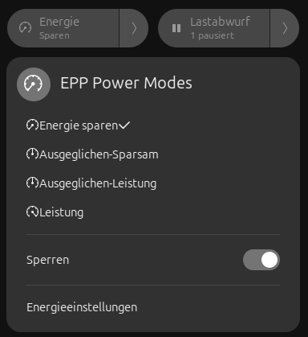

# EPP Power Modes

[**English**](README.md) | [Deutsch](README.de.md) | [Español](README.es.md)

A GNOME Shell (46+) Quick Settings extension for four fixed CPU
energy-performance-preference (EPP) states:

| Mode                    | EPP                    | `platform_profile` |
|--------------------------|-------------------------|---------------------|
| Power Saver              | `power`                 | `low-power`          |
| Balanced-Saver            | `balance_power`         | `low-power`            |
| Balanced-Performance      | `balance_performance`   | `balanced`            |
| Performance               | `performance`           | `performance`         |

`platform_profile` only has three tiers against four EPP levels;
Balanced-Saver shares the `low-power` tier with Power Saver rather than
with Balanced-Performance, because on ThinkPad DYTC hardware
`platform_profile` — not EPP — drives the fan curve. EPP is the finer knob
within that shared tier.

Plus a **Lock** switch that blocks automatic (firmware/ACPI-hotkey) drift
without affecting manual selection, and a **battery safety net** that
enforces at least `Balanced-Saver` below 20% while discharging, unaffected
by Lock. A manually selected `Power Saver` remains active. Toggling Lock
keeps the menu open and stores the policy immediately. If the next enforcement
attempt fails, Lock is disabled again instead of claiming protection that the
hardware could not provide.

Successor to
[`power-saver-epp-fix`](https://github.com/shell-extensions/power-saver-epp-fix);
see [PLAN.md](PLAN.md) for the full design rationale.



## Hardware status

The tile reads every available CPU EPP value directly from sysfs. It refreshes
after local changes, when the menu opens and every five seconds, so external
EPP changes are visible even with Lock disabled. The four exact values map
directly to the four modes above. Conflicting CPU values are shown as
**Mixed**; unreadable or unsupported EPP values as **Unknown**.
On systems without a `platform_profile` interface, EPP works independently.
When the interface is available, the helper verifies that EPP and platform
profile stay consistent. With Lock enabled, drift is reverted. With Lock
disabled, external platform drift is adopted: `balanced` maps to
`Balanced-Performance`; `low-power` maps to `Power Saver` unless the CPUs
already expose `balance_power`, in which case it maps to `Balanced-Saver`.
On newer kernels, provider-specific interfaces below
`/sys/class/platform-profile/` are authoritative for reading and verification.
The helper prefers the legacy `/sys/firmware/acpi/platform_profile` aggregate
as the kernel-coordinated write path and falls back to direct provider writes
only when that aggregate is unavailable or rejects the request. On some
ThinkPad DYTC firmware, a `platform_profile` write can be silently rejected
regardless of AC/battery state or proximity to the preceding EPP/PPD writes
(see
[`docs/power-saver-platform-profile-diagnose.de.md`](docs/power-saver-platform-profile-diagnose.de.md)
for the measurement behind this). Rather than fail the whole mode change over
that, the helper treats an unconfirmed platform profile as pending: EPP and
`power-profiles-daemon` stay in effect, the tile swaps to a syncing icon in
place of the selected mode's own icon, a **Platform profile pending** row
appears in the menu, and the background reassert keeps retrying (rate-limited
to avoid hammering the firmware) until the hardware confirms.

The installer keeps `power-profiles-daemon` active but restarts it with its
`platform_profile` driver blocked, using the guard proven by
`power-saver-epp-fix`. The helper first selects PPD's matching coarse profile,
waits for its CPU write, then applies and verifies the exact EPP and platform
state above. Uninstalling removes the guard and restarts PPD normally.

## Install

```sh
bash install.sh
```

Installs a root helper to `/usr/local/bin/eppmode-helper`, a
passwordless sudoers rule scoped to that single binary
(`/etc/sudoers.d/eppmode`), and systemd units for boot restore, lock
drift-reassertion and the battery safety-net poll. Requires `sudo`.

## Uninstall

```sh
bash uninstall.sh
```

Removes the helper, sudoers rule, systemd units, udev rule and state
directory. Remove the GNOME Shell extension itself separately, e.g.:

```sh
gnome-extensions uninstall eppmode@yurij.de
```

## Translations

English (source), German and Spanish. To regenerate `po/eppmode.pot`
and rebuild the compiled `.mo` files after editing `extension.js` or a
`.po` file:

```sh
tools/build-locale.sh
```

## License

GPL-3.0-or-later, see `LICENSE`.
